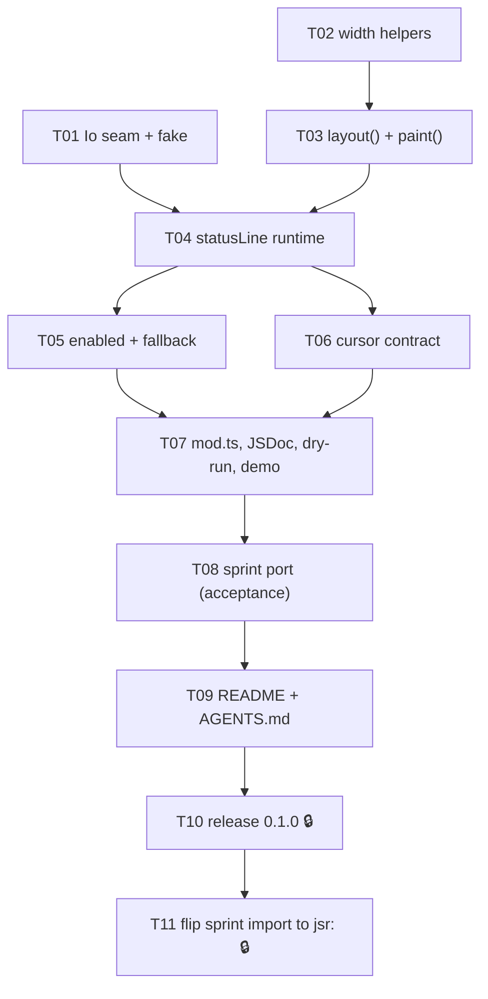

<!--
GENERATED ANALYSIS — @marianmeres/cli-status-line (v1 implementation plan)
Produced 2026-08-26 by inline research → verification against the reference implementation → synthesis.
Reference claims verified against @marianmeres/agents at commit c252835 (sprint/src/activity.ts, proc.ts, agent.ts).
This repository is an unborn scaffold (no commits yet); scaffold facts verified on disk. Planning artifact; no code was changed.
-->

# @marianmeres/cli-status-line — v1 Plan Overview & Roadmap

> **Verdict on the proposal: sound, and unusually honest about its own gaps.** The scope
> boundary (renderer + state model in; the `stream-json` interpreter and `readAll` out) is the
> right cut, the six "known defects — do not copy" all exist at the cited lines in
> `sprint/src/activity.ts`, and the behaviour contracts in §6 are the ones a _library_ has to
> honour that a _process-owning_ implementation may skip. Nothing in it needs rethinking. This
> plan pins the illustrative API into a concrete one, resolves all six open questions, and adds
> four things the proposal missed.

> **The three things that matter most.** First, make the line composition a **pure function**
> (`layout(snapshot, columns)`) with colour painted afterwards — the never-wrap guarantee and the
> width-aware degradation ladder are only trustworthy as plain-string goldens, and the reference
> is one refactor away from that shape already. Second, **draw only on the interval tick, never
> on `set()`** — this deletes the proposal's coalescing/dirty-flag design rather than
> implementing it, and resolves open question 4 (immediate first draw) as moot. Third, **do the
> sprint port inside this plan**, before the docs — it is the only consumer, and the only honest
> test that the interpreter/renderer seam is in the right place.

> **What the proposal missed** (all verified, all cheap): `Deno.env.get` throws `NotCapable`
> without `--allow-env`, so the seam's `env()` must swallow or `statusLine()` crashes on
> construction under narrow permissions; the exit hook is listed as a platform call in §7.1 but
> absent from the §7 `Io` interface (added as `onExit`); a newline or control character in
> `detail` breaks the single-line contract and the library cannot rely on the caller's `flat()`
> (added `sanitize()`); and `"⚒️"` with a variation selector measures 1 column via `unicodeWidth`
> but renders 2 in most terminals — counter glyphs must be text-presentation.

> **How to read this directory.** [`01-renderer.md`](./01-renderer.md) is the width/layout/redraw
> core, [`02-io-and-lifecycle.md`](./02-io-and-lifecycle.md) is the platform seam and every
> "never do X to the host" contract, [`03-verification-port-and-release.md`](./03-verification-port-and-release.md)
> is tests, the sprint port, docs, and JSR. [`PROGRESS.md`](./PROGRESS.md) holds the tasks, the
> decisions, and how to resume.

## Review of the proposal, section by section

| §                    | Verdict            | Note                                                                                                                                                                                                     |
| -------------------- | ------------------ | -------------------------------------------------------------------------------------------------------------------------------------------------------------------------------------------------------- |
| 1–3 scope & boundary | agree              | Interpreter stays in sprint; no `/claude` submodule, no parser option. `readAll` stays in `proc.ts`.                                                                                                     |
| 4 layout             | agree, **fixed**   | Segment/priority system rejected for v1 (D1). The ladder is unchanged; the missing piece is the hard `columns - 1` budget.                                                                               |
| 5 API                | agree with edits   | Counters kept as declared-up-front + `inc()` (D2). No `succeed()`/`fail()` sugar (D3). `pause()`/`resume()` kept with pinned semantics (must erase synchronously — `confirm()` blocks the loop).         |
| 6.1 width            | agree              | `@std/cli/unicode-width` verified stable at 1.0.32. Added grapheme-safe truncation and input sanitization.                                                                                               |
| 6.2 tty              | agree with one fix | "Timestamped" → _elapsed clock_; that is what the reference emits and what "no loss of behaviour" needs.                                                                                                 |
| 6.3 cursor           | agree              | Default off, `onExit` restore, no signal listeners (D7).                                                                                                                                                 |
| 6.4 redraw           | **simplified**     | Tick-only drawing. No dirty-for-redraw flag, no coalescing code, no "quiet period" question (D4).                                                                                                        |
| 6.5 unref            | agree              | `io.unrefTimer(id)` right after `setInterval`.                                                                                                                                                           |
| 6.6 lifecycle        | agree              | Every public method wrapped; post-stop no-ops; erase only if drawn. Added: undeclared `inc()` key is a no-op (D8).                                                                                       |
| 6.7 resize           | agree              | Re-read `columns()` per tick; no `SIGWINCH`.                                                                                                                                                             |
| 6.8 log/clog         | **decided**        | Zero `console.*` in `src/`; all output via `io.write`, so the ecosystem's clog rule (ecosystem.md:65) does not trigger (D5).                                                                             |
| 7 seam               | agree, extended    | + `onExit`; `env()` never throws; timers stay out of the seam — `FakeTime` drives them in tests (D11).                                                                                                   |
| 7.1 npm              | **already done**   | _(Downgraded from the draft's "live defect" — the owner removed `npm:build`/`npm:publish`/`@marianmeres/npmbuild` before this plan; `deno.json:5-17` verified clean.)_ Deno-only v1, seam kept (D6).     |
| 8 deps               | agree              | `@std/cli`, `@std/fmt` runtime; `@std/assert`, `@std/testing` dev. Drop the scaffold's unused `@std/fs`, `@std/path`. `@std/cli` `Spinner` is `@experimental`, frames + message only — nothing to reuse. |
| 9 acceptance         | agree, scheduled   | T08, before docs. Sprint keeps its byte-identical redirected form via a custom fallback function (D12).                                                                                                  |
| 10 defects           | all confirmed      | `.slice` at :123; `Math.max(8, …)` at :119; render-per-event at :151; `writeSync` return ignored at :32; `Deno.*` at :32/:40/:51/:102; `setInterval` un-unref'd at :133.                                 |
| 11 layout            | agree, +1 file     | `src/layout.ts` split from `status-line.ts` so the pure composer is a module of its own.                                                                                                                 |

Two repository facts the proposal could not know: the repo is **unborn** (no commits), so the
scaffold plus these docs must be committed on `master` before any sprint branch can exist; and
the placeholder `src/cli-status-line.ts` fails `deno lint` (`no-slow-types`), so `deno lint`
cannot be a sprint-1 `Verify:` line until T01 deletes it.

## Top recommendations across all dimensions (ranked)

| Rank | Recommendation                                                                   | Dimension (doc)                                | Value | Effort | Risk | Why now                                                              |
| ---- | -------------------------------------------------------------------------------- | ---------------------------------------------- | ----- | ------ | ---- | -------------------------------------------------------------------- |
| 1    | `Io` seam with drain loop, permission-safe `env`, `onExit` (T01)                 | [02](./02-io-and-lifecycle.md) #1              | high  | S      | low  | Everything else is untestable without it                             |
| 2    | Width helpers: `truncateToWidth`, `sanitize` (T02)                               | [01](./01-renderer.md) #1                      | high  | S      | low  | The single largest correctness gap vs. the reference                 |
| 3    | Pure `layout()` + `paint()`, ladder, hard budget (T03)                           | [01](./01-renderer.md) #2                      | high  | M      | med  | The product; goldens pin the never-wrap guarantee                    |
| 4    | `statusLine()` runtime: tick-only draw, unref, stop/pause/log, never-throw (T04) | [02](./02-io-and-lifecycle.md) #3              | high  | M      | med  | Turns the pure core into the library                                 |
| 5    | Enabled detection + fallback policies via `io.write` (T05)                       | [02](./02-io-and-lifecycle.md) #2              | high  | S      | low  | Sprint's redirected-output form depends on it                        |
| 6    | Sprint port as acceptance (T08)                                                  | [03](./03-verification-port-and-release.md) #3 | high  | M      | med  | The only honest test of the seam; may correct the API                |
| 7    | README + AGENTS.md per the guides (T09)                                          | [03](./03-verification-port-and-release.md) #4 | high  | M      | low  | After the port so the API is frozen                                  |
| 8    | Release 0.1.0 to JSR (T10, human-only)                                           | [03](./03-verification-port-and-release.md) #5 | high  | S      | low  | Irreversible; last                                                   |
| 9    | Cursor-hiding contract (T06)                                                     | [02](./02-io-and-lifecycle.md) #4              | med   | S      | low  | Opt-in; small, but the contract must be documented before publish    |
| 10   | Public surface, JSDoc, `publish --dry-run`, demo script (T07)                    | [03](./03-verification-port-and-release.md) #2 | med   | S      | low  | JSR scores docs; the demo is the manual check goldens cannot replace |
| 11   | Flip sprint's import to `jsr:` (T11)                                             | [03](./03-verification-port-and-release.md) #5 | med   | S      | low  | Closes the loop after publish                                        |

**Deliberately deferred** (ids retired in `PROGRESS.md`, each with a revisit trigger):
`succeed()`/`fail()`/`warn()` sugar — `stop({ text })` covers it; revisit when a second consumer
asks. Node adapter in `io.ts` — ~40 lines behind the seam; revisit when a Node consumer exists.
Segment/priority layout system — revisit when a caller needs a different order than the fixed
one. Multi-line regions, progress bars, prompts — out of scope by design (proposal §2), sibling
packages if ever.

## Recommended first sprint (do these 5 first)

**T01 — `Io` seam.** First because every other test needs the memory fake, and because it is
where the two "crash on construction" traps live (`env()` under narrow permissions,
`consoleSize()` off-tty). Also deletes the scaffold placeholders that keep `deno lint` red.
Detail: [02](./02-io-and-lifecycle.md) #1.

**T02 — width helpers.** Independent of T01; pure functions with an exhaustive little test
matrix (CJK, emoji, combining, ANSI, `max` below the ellipsis). This is the fix for the
proposal's "single largest correctness gap". Detail: [01](./01-renderer.md) #1.

**T03 — pure `layout()`/`paint()`.** The product. Golden outputs at eleven widths plus a property
loop asserting the line never exceeds `columns - 1`. Colour after truncation, verified by
comparing `paint()` with colour off to the plain join. Detail: [01](./01-renderer.md) #2.

**T04 — the runtime.** `statusLine()` with tick-only drawing, unref'd interval, `stop()`,
`pause()`/`resume()`, `log()`, and the never-throw wrapper — every semantic in
[02](./02-io-and-lifecycle.md) #3 is one byte-exact golden against the fake + `FakeTime`.

**T05 — enabled detection and fallback.** Small, but it is what sprint's `> log` form depends on
and where the "zero `console.*`" decision becomes checkable. Detail:
[02](./02-io-and-lifecycle.md) #2.

After sprint 1 the library is functionally complete for a tty and a log file; sprint 2 is the
cursor contract, public-surface polish, the port, docs, and release.

## Cross-cutting themes

- **Never-throw, never-hold, never-change-how-the-host-dies.** Appears in the seam (D-adapters
  swallow), the runtime (method wrappers, unref'd timer, post-stop no-ops), and the cursor
  contract (no signal listeners). A progress indicator that can kill a long-running job is worse
  than none.
- **Measure plain, paint last.** Width is computed on sanitized, uncoloured strings; colour and
  `\r`/`\x1b[K` are added only in `paint()` and the runtime.
- **Pure core, thin shell.** `width.ts` and `layout.ts` have no I/O and no `Deno`; `io.ts` is
  the only file that does. Tests are goldens over the byte stream, not mocks of behaviour.
- **The consumer is the spec.** Sprint's rendered shape, clock format, and redirected form are
  the acceptance criteria; API doubts are settled by what the port needs, not by generality.

## Dependency / sequencing notes

Every edge above is mirrored in the `Deps` column of [`PROGRESS.md`](./PROGRESS.md).

## Completeness check

- **Node adapter** — doc 02 keeps `unrefTimer(id: number)`; a Node port changes that to `unknown`.
  Private type, no public impact; noted so it is not a surprise.
- **`elapsedMs` after `stop()`** — frozen (doc 02 #3); the proposal did not say. The port does not
  read it; sprint's own timing lives in `agent.ts`.
- **`log()` before the first tick / while paused** — writes the message; the erase is skipped
  because nothing is drawn. Covered by the `drawn` flag semantics, worth one explicit golden.
- **Windows** — `\r` + `\x1b[K` and `?25l/h` work on Windows Terminal and modern conhost with VT
  processing on; Deno enables it. Not tested here; noted in the README as "untested".
- **Publishing `docs/`** — `deno.json` has no `publish.exclude`, so `docs/v1-plan/` ships to JSR.
  Sibling packages (`clog`, `kv`) do the same; consistent with the ecosystem, not flagged.
- **Nothing found missing across docs** — the three dimensions were cross-read; the only item
  that moved was sanitization (raised in 01, consumed by 02 #3's never-throw contract).

Source documents: [`01-renderer.md`](./01-renderer.md),
[`02-io-and-lifecycle.md`](./02-io-and-lifecycle.md),
[`03-verification-port-and-release.md`](./03-verification-port-and-release.md).
